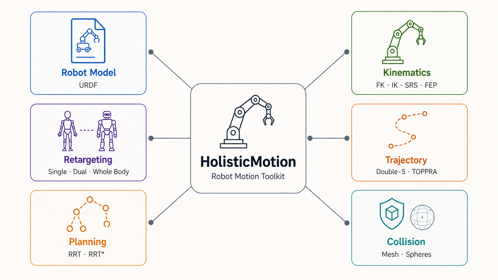

# HolisticMotion

[English](README.md) | 简体中文

HolisticMotion 是一个带 Python 绑定的 C++17 机器人运动库，提供运动学、运动规划、
轨迹生成、碰撞查询和姿态重定向。机器人模型由调用方通过明确的 URDF 路径提供。



## 功能

| 模块 | 能力 |
| --- | --- |
| 运动学 | URDF 模型、FK/IK，以及数值、OPW、UR、SRS、FEP 求解器 |
| 规划 | 零空间规划、RRT-Connect、RRT*、Informed RRT* 和可行路径优化 |
| 轨迹 | Double-S、梯形速度、TOPPRA，以及可选的可微 PyTorch 重定时 |
| 碰撞 | 可选的 Pinocchio/Coal 网格查询和球体模型 |
| 重定向 | 手臂、腿部、全身，以及可选的手部重定向 |

CUDA 批处理后端和 Viser 示例均为可选功能。规划无需 OMPL；TOPPRA 实现由本仓库维护。

## 快速开始

需要 C++17 编译器、CMake 3.22+、Conan 2 和 Python 3.9+。
依赖配置和 C++ 用法参见[安装指南](docs/zh_CN/installation.md)。

```bash
./scripts/build.sh
source scripts/activate.sh
```

默认构建包含 Python 绑定和碰撞组件。加入 `--cuda` 启用 CUDA，`--no-collision`
精简构建，或 `--tests` 运行测试。也可用 `./scripts/run.sh python3 ...` 在本地安装
环境中运行单条命令。

```python
import holistic_motion as hm

robot = hm.Robot("/absolute/path/to/robot.urdf")
q = [0.0] * robot.dof
pose = robot.kinematics.forward(q)
```

无需安装外部 TOPPRA 即可对路点路径进行重定时：

```python
from holistic_motion.trajectory import ToppraTrajectory

trajectory = ToppraTrajectory(
    [[0.0, 0.0], [0.4, -0.2], [1.0, 0.5]],
    max_velocity=[1.0, 0.8],
    max_acceleration=[2.0, 1.5],
)
times, positions, velocities, accelerations = trajectory.sample_uniform(200)
```

可选 Python 依赖组包括 `differentiable`、`retargeting`、`hand-retargeting` 和
`examples`。安装方法和运行要求见下方对应指南。

## 文档与示例

- [运动学与核心概念](docs/zh_CN/concepts.md)
- [运动规划](docs/zh_CN/planning.md) · [轨迹生成](docs/zh_CN/trajectory.md)
- [碰撞查询与球体拟合](docs/zh_CN/collision.md)
- [姿态重定向](docs/zh_CN/retargeting.md)
- [可运行示例](examples/README.md) · [完整文档](docs/zh_CN/index.md)

执行 `python -m pip install '.[docs]'`，再运行 `./scripts/docs.sh`，即可在本地
生成中英文文档。

## 开发

```bash
./scripts/build.sh --tests
conan create . --no-remote -o '&:with_python=False'
```

测试、基准和贡献说明见[开发指南](docs/zh_CN/development.md)。
依赖许可证和算法参考见[第三方声明](THIRD_PARTY_NOTICES.md)。
