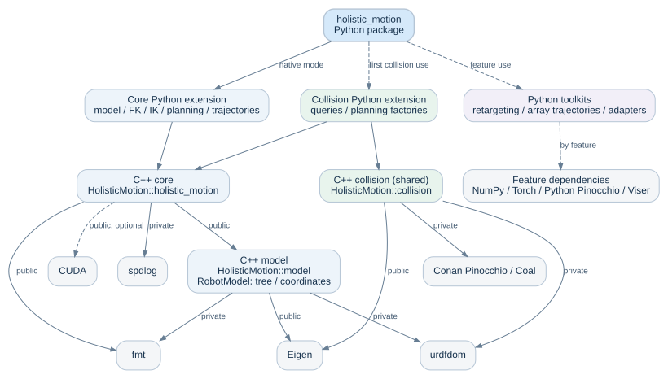

# Architecture and extension boundaries

English · <a href="../zh_CN/architecture.html">简体中文</a>

HolisticMotion separates model preparation, read-only numerical queries and
request-local search state. The C++ model and core remain usable without collision
or Python. Python adds input conversion, runtime loading and optional numerical
toolkits. Applications supply robot assets and decide how models, callbacks and
workers are owned.

Arrows point toward dependencies. Edge labels distinguish public and private
C++ dependencies; dashed arrows indicate optional features or on-demand loading.
All three C++ components also provide direct consumer entry points.

## Dependency direction

| Layer | Responsibility | Dependency boundary |
|---|---|---|
| C++ model | Parsed robot tree, scalar coordinates and visual metadata | Public Eigen; private fmt and urdfdom |
| C++ core | Robot default chain/solver, manifolds, FK/IK, joint-space planning and trajectories | Public model and fmt; private spdlog; optional public CUDA backend |
| C++ collision | Full-model configuration mappings, mesh and sphere queries | Always shared; public Eigen; private Pinocchio, Coal and urdfdom |
| Core Python extension | Native value conversion, solver and planning APIs | C++ core and pybind11 |
| Collision Python extension | Collision types and collision-aware planning factories | C++ core and collision libraries; loaded on first collision use |
| Python toolkits | Retargeting, array trajectory algorithms and optional visualization adapters | Feature-specific dependencies loaded when needed; a toolkit-only installation can omit native libraries |
| Optional NVIDIA planner | cuRobo v2 RRT, optimization and TimeOpt through `CuroboPlanner` | Loads cuRobo/Torch/Warp/CUDA on construction; independent of the native collision component |

`RobotModel` loads model data without selecting a chain or constructing IK.
`Robot` combines that model with the selected default chain and solver.
The collision library does not link the core. Its planning factories live in
the collision Python extension, where both sets of native types are available.
This keeps core-only consumers independent of collision SDK discovery.
CMake component consumers are tested with unrelated dependency discovery
explicitly disabled.

Core and collision Python extensions verify a native build identity before
exchanging C++ objects. The identity includes native sources, build options,
compiler information, dependency versions, and the selected Python/pybind11 ABI.
A mismatch raises an import error
before type registration or planning-factory installation. This detects mixed
builds; it is not a general C++ ABI compatibility guarantee. See
{doc}`installation` for rebuilding and {doc}`collision` for the process boundary
between Conan collision dependencies and independently installed Python
Pinocchio.

## Prepared data and query ownership

| Component | Persistent state | Per-query state |
|---|---|---|
| `RobotModel` | Parsed tree, scalar coordinates and visual metadata | Tree/path queries without solver construction |
| `Robot` | Composed model, selected default chain and solver | Compatibility queries and explicit chain solver creation |
| SRS kinematics | Prepared canonical geometry, model, limits and TCP configuration | Candidate sets, refinement data and caller-owned results |
| Numerical and FEP kinematics | Model and solver configuration | Iteration buffers, batches and independent results |
| `JointSpace` | Shared immutable limits, weights, names and topology | Builders publish a new snapshot; reads and copies do not mutate existing data |
| Sampling planner and path optimizer | Joint-space snapshot and callback wrappers | Owned endpoints/path, options, callback copies and search workspace |
| CUDA batch backend | Backend availability and compiled kernels | RAII device buffers and request-local transfers |
| Collision models | Prepared geometry and mutable FK/distance workspace | Queries update that workspace; use one model per worker |
| Retargeting sessions | Model, mode plans, warm start and per-mode workspace storage | Concrete algorithms build and use their numerical workspaces; one session per worker |

DLS and Pink solvers share model, mode and warm-start session operations rather
than inheriting one another's algorithms. Each creates its own numerical
workspaces; Curobo reuses Pink's optimizer and adds multi-seed scheduling.

SRS preparation runs when the model changes, rather than repeating canonical
geometry discovery inside each solve. Scalar built-in FK traverses directly to
the terminal pose without allocating the complete frame sequence. Built-in
Jacobian queries use the same traversal and fill the caller's matrix directly.
SRS null-space projection uses a fixed-size Jacobian and SVD workspace on the
stack; it retains no per-solver mutable cache. `GetAllFK()`
retains its full-frame contract, including virtual dispatch for custom numerical
subclasses.

`CollisionModel::Clone()` / Python `clone()` creates a deep in-memory snapshot
of the current geometry, obstacles and pair selection, with fresh FK and
collision workspaces. Create worker copies from a quiescent source before
starting parallel planning. Cloning does not reread the URDF or mesh files and
copies geometry storage rather than sharing mutable query state.

Collision factories prepare one immutable joint selection and reference
configuration. Callback/request copies share that context; each state query
still creates its own full configuration. Caller edits after factory creation
cannot change the prepared context. Collision and distance-cache workspaces
retain their per-worker ownership.

Planning copies request inputs and callbacks before calling user code. A
callback may replace the owner's configuration for a subsequent request without
changing the active request's objective or coordinate contract. Captured objects
are not cloned: sharing a callback that captures a collision model still shares
that model's mutable workspace. Result objects retain the request's `JointSpace`
snapshot. See {doc}`planning` for periodic coordinate handling and callback
lifetimes.

## Python execution boundary

Read-only built-in IK, SRS null-space projection/planning and batch operations
release the GIL after copying inputs; result conversion reacquires it. Unknown custom solvers keep the conservative
calling contract unless they explicitly advertise compatible concurrent queries.
The capability is a promise by the implementation, including its use of Python
APIs, captured state and output ownership.

`SamplingPlanner` and `PathOptimizer` expose `release_gil=True` as an explicit
keyword. Its default preserves native callbacks that expect the GIL; Python callbacks reacquire it in either
mode. Callback copies retain Python references safely through request teardown.
On CPython, the planner bindings expose their callback edges to cycle collection;
collision factory callbacks also expose their resource references. Native C++
callback copies retain those resources until the copy is destroyed, including
copies held outside the Python object graph. Borrowed C++ objects keep the
lifetime rules of their external owner. PyPy's tested native callback cycles
require explicit callback clearing.

The extension does not declare execution without a GIL safe. Loading it into a
free-threaded CPython build enables the GIL. Concurrent setters are also outside
the shared-query contract. These boundaries are distinct from numerical
parallelism and must remain explicit when adding bindings.

## Compilation boundaries

Public headers define the API under `holistic_motion/`; private traversal,
periodic-angle and template implementation helpers stay under `src/`. Python
reference handling stays under `bindings/python/` and does not add a Python
dependency to the core.

Planning collector hooks use pybind11's instance metadata to find owned native
holders, including partially constructed objects and multiple native bases.
Traversal reports borrowed callback pointers without creating Python references.
Keep the minimum-Python and alternate-ABI regressions when upgrading pybind11;
user-defined C++ functors remain responsible for any opaque Python references
they capture.

Heavy trajectory templates share private implementation headers and instantiate
dimensions in four translation units: 1–8, 9–16, 17–24 and 25–32. The first batch
also includes the supported Cartesian types. This reduces individual compiler
memory peaks and the amount of unrelated code pulled from a static archive.
Keep each supported instantiation in exactly one batch and verify external
consumers after changing these boundaries.

`JointSpace` now stores a shared immutable implementation. Its C++ object layout
changed, so applications and extension modules compiled against the earlier
layout must be rebuilt together with the SDK. The public methods retain their
coordinate and ownership semantics.

## Algorithm and backend selection

| Entry point | Implementation | Execution boundary |
|---|---|---|
| Native FK/IK, SRS/FEP and sampling planners | HolisticMotion C++ algorithms | CPU; optional native CUDA build accelerates supported FEP batch operations |
| `PinocchioRetargetingSolver` | Local damped least-squares IK using Python Pinocchio | Stateful CPU session per worker |
| `PinkRetargetingSolver` | Local bounded Pink-style task optimizer | No upstream Pink or qpsolvers runtime |
| `CuroboRetargetingSolver` | Local multi-seed scheduling of the Pink-style optimizer | No NVIDIA cuRobo, Torch, Warp or CUDA runtime |
| `CuroboPlanner` | NVIDIA cuRobo v2 planner, optimization and TimeOpt | Separate optional GPU runtime; backend calls serialize across instances within a process |
| `ToppraTrajectory` | Local NumPy path timing | Does not import the external TOPPRA package |
| `TorchToppraTrajectory` | Local optional Torch path timing | Differentiability follows supported autograd operations; see {doc}`trajectory` |

Native `--cuda` and the NVIDIA planner's CUDA environment are configured
independently. Ordinary toolkit import does not initialize either device backend.
Use {doc}`curobo_v2_fast` for the qualified upstream revision and GPU ownership
rules. Coordinate packing and frame conversion are covered in
{doc}`coordinate_contracts`.

## Reviewing an extension

Start by identifying whether new state belongs to model preparation, a query or
a worker. Keep mutable query buffers out of shared prepared solvers. State the
concurrency contract before advertising capabilities or releasing the GIL.
Optional features should keep their dependencies behind their component or
toolkit boundary.

Validate numerical behavior independently of the implementation: FK/IK pose
round trips, physical-angle equivalence, finite-difference derivatives or
external installed consumers as appropriate. Tests that exercise callbacks must
also cover exceptions, reentrant replacement and ownership. Use the compiler,
sanitizer and backend checks described in {doc}`development`; benchmark equal
work and compare outputs before interpreting timing differences.
