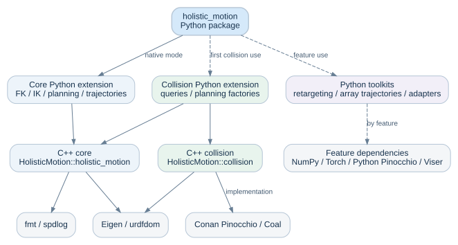

# 架构与扩展边界

<a href="../en/architecture.html">English</a> · 简体中文

HolisticMotion 将模型准备、只读数值查询和请求局部搜索状态分开。C++ 核心可以在
不启用碰撞或 Python 的情况下使用；Python 层负责输入转换、运行时加载及可选数值
工具。机器人资源由应用提供，模型、回调和 worker 的所有权也由应用明确安排。

箭头指向依赖项，虚线表示按功能加载的可选依赖；两个 C++ 库也可由消费端直接使用。

## 依赖方向

| 层次 | 职责 | 依赖边界 |
|---|---|---|
| C++ 核心 | 标量运动链、流形、FK/IK、关节空间规划和轨迹 | Eigen、urdfdom、fmt、spdlog，以及可选 CUDA 后端 |
| C++ 碰撞组件 | 完整模型坐标映射、网格与球体碰撞查询 | 公共接口依赖 Eigen；实现依赖 Pinocchio、Coal 和解析库 |
| Python 核心扩展 | 原生值转换、求解器与规划 API | C++ 核心和 pybind11 |
| Python 碰撞扩展 | 碰撞类型及碰撞规划工厂 | 两个原生组件；首次使用碰撞功能时加载 |
| Python 工具包 | 重定向、数组轨迹算法及可选可视化适配 | 按功能加载依赖；toolkit-only 安装可以不包含原生库 |

碰撞库不链接核心库。碰撞规划工厂位于 Python 碰撞扩展中，由该扩展同时使用两组
原生类型，避免普通核心消费端引入碰撞依赖图。CMake 组件消费端测试会显式禁用
无关依赖的查找，检查这一边界。

Python 核心与碰撞扩展在交换 C++ 对象前核对原生构建标识。标识包含原生源码、
构建选项、编译器信息、依赖版本及所选 Python/pybind11 ABI；不一致时，在类型注册或安装规划工厂前报告
导入错误。它用于发现混装构建，不是通用 C++ ABI 兼容性保证。重建方式见
{doc}`installation`；Conan 碰撞依赖与独立安装的 Python Pinocchio 之间的进程
边界见 {doc}`collision`。

## 预备数据与查询所有权

| 组件 | 持久状态 | 单次查询状态 |
|---|---|---|
| SRS 运动学 | 预备规范几何、模型、限位及 TCP 配置 | 候选集、精化数据及调用方独立输出 |
| 数值与 FEP 运动学 | 模型及求解配置 | 迭代缓冲、批处理输入和独立输出 |
| `JointSpace` | 共享不可变的限位、权重、名称和拓扑 | builder 发布新快照；读取与复制不修改已有数据 |
| 采样规划器和路径优化器 | 关节空间快照及回调包装 | 独立持有的端点或路径、选项、回调副本与搜索工作区 |
| CUDA 批处理后端 | 后端可用性及已编译内核 | RAII 设备缓冲和请求局部传输 |
| 碰撞与重定向模型 | 预备拓扑，以及可变 FK、距离或优化工作区 | 查询更新工作区；各 worker 使用独立模型 |

SRS 在模型变化时准备规范几何，避免每次求解重复发现相同结构。内置标量 FK
直接遍历到末端位姿，不再为完整帧序列分配数组；`GetAllFK()` 保留完整帧接口，
自定义数值求解器子类也保留其虚函数分派语义。内置雅可比查询复用同一遍历，
直接填充调用方矩阵；SRS 零空间投影的固定尺寸雅可比与 SVD 工作区放在栈上，
不引入求解器级可变缓存。

`CollisionModel::Clone()` / Python `clone()` 深拷贝内存中的几何体、障碍物和
碰撞对选择，并创建独立的 FK 与碰撞查询工作区。并行规划开始前，应从没有活动
查询或更新的源对象创建各 worker 副本。该过程不再读取 URDF 或网格文件，几何
存储也会复制。

碰撞工厂一次性准备不可变的关节选择与参考配置。回调和请求副本共享这份上下文，
每次状态查询仍创建独立的完整配置。工厂创建后，调用方修改原始输入不改变已准备
的上下文；碰撞与距离缓存工作区仍由各 worker 独立持有。

规划在调用用户代码前复制请求输入和回调。回调重入修改所有者配置只影响后续
请求，不改变当前请求的目标或坐标契约。捕获对象不会被深拷贝：共享一个捕获碰撞
模型的回调，仍然会共享该模型的可变工作区。结果对象持有本次请求的 `JointSpace`
快照。周期坐标处理和回调生命周期见 {doc}`planning`。

## Python 执行边界

内置只读 IK、SRS 零空间投影及规划、批处理操作在复制输入后释放 GIL，
输出转换时重新获取 GIL。
未知自定义求解器保持保守调用契约，除非其实现显式声明支持兼容的并发查询。
这一能力声明同时覆盖 Python API 使用、捕获状态和输出所有权。

`SamplingPlanner` 和 `PathOptimizer` 通过显式关键字 `release_gil=True` 启用释放；
默认行为保留需要 GIL 的原生回调契约。两种模式下，Python 回调都会重新获取 GIL。请求中的回调副本会
安全持有 Python 引用直至请求结束。CPython 绑定向循环回收器暴露回调引用边；
碰撞工厂回调也会暴露其资源引用；原生 C++ 回调副本独立持有资源，
包括 Python 对象图之外的副本，直至副本销毁。借用的 C++ 对象仍遵循外部所有者的
生命周期。已测试的 PyPy 原生回调循环需要显式清除回调。

扩展没有声明支持无 GIL 执行；在 free-threaded CPython 中加载时会启用 GIL。
并发 setter 也不属于共享查询契约。这些边界与数值计算能否并行不同，新增绑定时
应分别说明。

## 编译边界

公共 API 位于 `holistic_motion/` 头文件路径下；遍历、周期角度和模板实现辅助
保持在私有 `src/` 中。Python 引用处理位于 `bindings/python/`，不向核心添加
Python 依赖。

规划回收钩子使用 pybind11 的实例元数据查找拥有所有权的原生 holder，并处理
尚未完成构造的对象和多个原生基类。遍历只报告借用的回调指针，不创建 Python
引用。升级 pybind11 时应保留最低 Python 版本与其他 ABI 的回归检查；用户自定义
C++ 函数对象仍负责其捕获的不透明 Python 引用。

较重的轨迹模板共用私有实现头，并按 1–8、9–16、17–24、25–32 维拆为四个
编译单元，第一组同时包含受支持的笛卡尔类型。该划分降低单个编译进程的内存峰值，
也减少静态归档中被拉入消费端的无关代码。每个受支持的显式实例化只应出现一次；
调整划分后应验证外部消费端。

`JointSpace` 现在持有共享不可变实现，C++ 对象布局已经变化。使用旧布局编译的
应用和扩展模块必须与 SDK 一起重建；公开方法保持原有坐标与所有权语义。

## 扩展评审

先确定新增状态属于模型准备、单次查询还是 worker。共享的预备求解器不应持有
可变查询缓冲；声明能力或释放 GIL 前，先明确并发契约。可选功能的依赖应保持在
对应组件或工具包边界内。

使用独立于实现的方式验证数值行为，例如 FK/IK 位姿往返、物理角度等价、有限
差分导数或外部安装消费端。涉及回调的测试还应覆盖异常、重入替换和所有权。
编译器、sanitizer 与后端检查见 {doc}`development`；基准应比较相同工作量，先
核对输出，再解释耗时差异。
